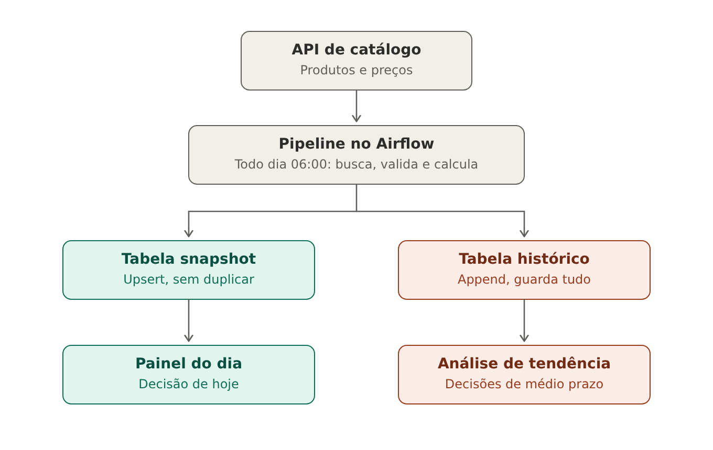
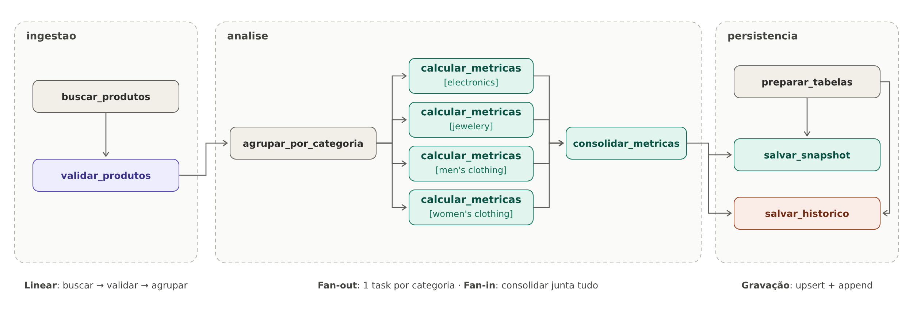
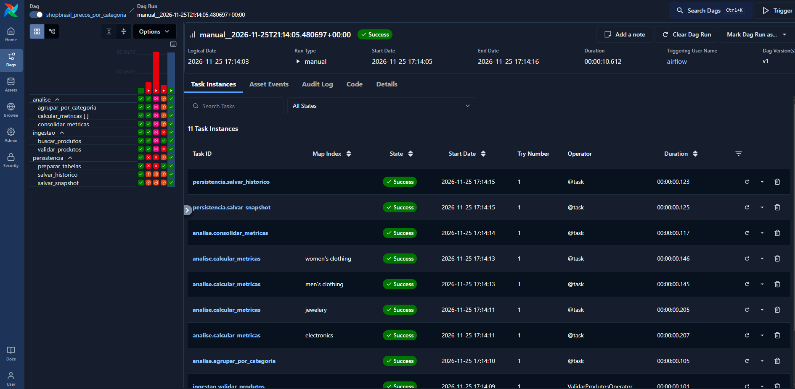
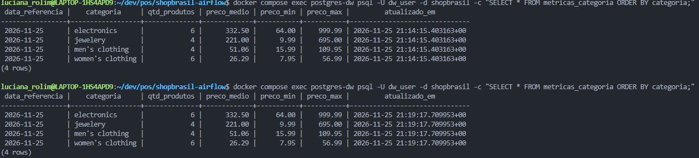
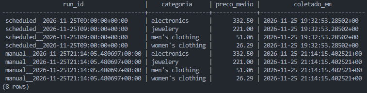

# ShopBrasil · Pipeline de preços por categoria

Pipeline no **Apache Airflow** que coleta diariamente o catálogo de produtos de uma API, calcula métricas de preço por categoria e grava o resultado num banco **PostgreSQL**.

## O problema

Todas as manhãs, o time de pricing da ShopBrasil consulta um painel com o preço médio, mínimo, máximo e a quantidade de produtos por categoria. Esse painel era alimentado por um script agendado via **cron**, que:

- **falhava em silêncio** quando a API oscilava, deixando o time sem dados;
- **duplicava os números** quando alguém rodava o script de novo;
- precisava ser **editado** a cada nova categoria.

## A solução

### Trocar o cron por um orquestrador

O cron só sabe **agendar e executar**: dispara o script no horário e não sabe se deu certo. A solução foi substituí-lo pelo **Apache Airflow**, um **orquestrador de pipelines**, que **agenda, executa e monitora** cada etapa.

No Airflow, o pipeline é descrito em Python como uma **DAG**: um conjunto de etapas (**tasks**) com uma ordem definida. Com isso, o Airflow consegue:

- rodar cada etapa separadamente e **tentar de novo só a que falhou**;
- **avisar** quando algo dá errado;
- mostrar numa interface web **o que rodou, quando e com qual resultado**;
- criar etapas **dinamicamente**, conforme os dados que chegam.

### Como cada problema foi resolvido

| Problema | Recurso usado | Como funciona |
|---|---|---|
| A API oscila e o script falha em silêncio | **Retry com backoff exponencial** + **callbacks** | A busca tenta até 6 vezes, esperando cada vez mais entre as tentativas. Se desistir, um `on_failure_callback` dispara um alerta. |
| Rodar de novo duplica os dados | **Gravação idempotente (UPSERT)** | Cada data + categoria tem uma única linha. Reprocessar **atualiza** a linha em vez de criar outra. |
| Cada nova categoria exige editar o código | **Dynamic Task Mapping** | O pipeline cria **uma task por categoria** encontrada nos dados. Uma categoria nova vira uma task nova, sem mudar o código. |
| Execução manual e sem controle | **Agendamento no fuso de Brasília** | O pipeline roda sozinho todo dia às 06:00 de Brasília, antes de o time chegar. |

Além disso, o histórico de preços é guardado numa segunda tabela, que permite acompanhar a evolução dos preços ao longo do tempo.

## Como funciona



Todo dia às 06:00, o pipeline busca os produtos na **API de catálogo**, valida os dados e calcula, para cada categoria, a quantidade de produtos e os preços médio, mínimo e máximo. O resultado é gravado em duas tabelas, cada uma com um papel:

- **Snapshot** (`metricas_categoria`): a **foto do dia**, com uma linha por data + categoria. Se o pipeline rodar de novo, a linha é **atualizada**, sem duplicar. É o que o **painel** lê para as decisões de hoje.
- **Histórico** (`metricas_categoria_historico`): o **diário**. Cada execução **acrescenta** suas linhas, o que permite **analisar tendências** e acompanhar a evolução dos preços.

### Tasks da DAG



As tasks são organizadas em três grupos: **ingestão** (buscar e validar os produtos), **análise** (calcular as métricas por categoria, em paralelo) e **persistência** (gravar no banco).

## Tecnologias

Apache Airflow 3.1.8 (TaskFlow API) · PostgreSQL 16 · Docker Compose · [FakeStore API](https://fakestoreapi.com)

## Estrutura

```text
dags/
├── pipeline_precos_categoria.py     # a DAG
└── shopbrasil/
    ├── config.py                    # configurações
    ├── sql.py                       # comandos SQL
    ├── callbacks.py                 # avisos de sucesso, retry e falha
    └── operators/
        └── validar_produtos.py      # operador customizado
docker-compose.yaml                  # Airflow + banco analítico
```

## Como rodar

### Requisitos

- Docker com Docker Compose **v2.14 ou mais novo** (no Windows, Docker Desktop com WSL2)
- Pelo menos **4 GB de memória** disponíveis para o Docker
- Portas **8080** (Airflow) e **5433** (banco analítico) livres

**Ambiente em que o projeto foi testado:** Windows com WSL2 (Ubuntu) · Docker 29.3.1 · Docker Compose v5.1.0 · Apache Airflow 3.1.8 · PostgreSQL 16

### Passo a passo

```bash
# 1. Baixar o projeto
git clone https://github.com/lucianarolimc/shopbrasil-airflow.git
cd shopbrasil-airflow

# 2. Configurar o usuário e criar as pastas que não vão para o repositório
echo "AIRFLOW_UID=$(id -u)" > .env
mkdir -p logs plugins config

# 3. Inicializar e subir o ambiente
docker compose up airflow-init     # aguarde "exited with code 0"
docker compose up -d
docker compose ps                  # aguarde todos ficarem "healthy" (1 a 2 min)

# 4. Criar o pool (limita a 2 os cálculos simultâneos)
docker compose exec airflow-scheduler airflow pools set ecommerce_pool 2 "Limita a concorrencia das tasks mapeadas"
```

### Depois de acessar o Airflow

1. Acesse <http://localhost:8080> e entre com usuário `airflow` e senha `airflow`.
2. No menu da esquerda, clique em **Dags**. A DAG `shopbrasil_precos_por_categoria` aparece na lista, **pausada** (toda DAG nova começa assim).
3. **Ative a DAG** pelo botão de liga/desliga ao lado do nome. Se o horário das 06:00 de hoje já passou, o Airflow executa essa rodada automaticamente.
4. Para rodar quando quiser, clique em **Trigger** (▷) → **Single Run** → **Trigger**.
5. Clique no nome da DAG e abra a aba **Graph** para acompanhar a execução. Em poucos segundos, todas as tasks devem ficar verdes, com uma instância de `calcular_metricas` para cada categoria.
6. Confira o resultado no banco analítico:

```bash
# Snapshot do dia (o que o painel lê): 1 linha por categoria
docker compose exec postgres-dw psql -U dw_user -d shopbrasil \
  -c "SELECT * FROM metricas_categoria ORDER BY categoria;"

# Histórico: as linhas de cada execução, acumuladas
docker compose exec postgres-dw psql -U dw_user -d shopbrasil \
  -c "SELECT run_id, categoria, preco_medio, coletado_em FROM metricas_categoria_historico ORDER BY coletado_em, categoria;"
```

**Para testar a idempotência:** na execução concluída, clique na task `persistencia.salvar_snapshot` → **Clear** e confirme. Depois de ela rodar de novo, consulte o snapshot outra vez: o número de linhas continua o mesmo e só o `atualizado_em` muda.

> Os horários na interface aparecem no fuso do navegador. Para ver no horário de Brasília, troque o fuso nas configurações do usuário (canto inferior esquerdo).

## Testes

**Execução completa:** todas as tasks com sucesso, uma instância de `calcular_metricas` por categoria.



**Idempotência:** após reprocessar o `salvar_snapshot`, a tabela continua com 4 linhas; só o `atualizado_em` muda.



**Histórico (append):** 2 execuções geram 8 linhas. O `run_id` `scheduled__...T09:00 UTC` confirma o agendamento às 06:00 de Brasília.



**Resiliência:** com a URL da API trocada por um endereço inválido, a task tenta 6 vezes com esperas crescentes e, ao desistir, dispara o alerta.

Durante as tentativas, o `on_retry_callback` registra cada nova tentativa:

```text
[2026-11-25T21:37:31Z] WARNING - [RETRY] dag=shopbrasil_precos_por_categoria task=ingestao.buscar_produtos tentativa=2 falhou e será executada novamente. Erro: HTTPSConnectionPool(host='fakestoreapi.invalido', port=443): Max retries exceeded with url: /products (Caused by NameResolutionError(... Failed to resolve 'fakestoreapi.invalido' ...))
```

Na 6ª tentativa, a task desiste e o `on_failure_callback` dispara o alerta simulado:

```text
[2026-11-25T21:41:24Z] ERROR - [ALERTA SIMULADO] Enviando para o canal #dados-alertas:
Pipeline ShopBrasil FALHOU!
dag=shopbrasil_precos_por_categoria task=ingestao.buscar_produtos tentativa=6
Erro: HTTPSConnectionPool(host='fakestoreapi.invalido', port=443): Max retries exceeded with url: /products (Caused by NameResolutionError(... Failed to resolve 'fakestoreapi.invalido' ...))
```

## Observações

- **Alerta via `on_failure_callback`:** o Airflow 3 removeu o SLA antigo.
- **`AIRFLOW__API_AUTH__JWT_LEEWAY: '300'`:** no WSL2, o relógio pode dar saltos e o Airflow recusa os tokens internos das tasks. A tolerância maior evita o erro no ambiente local.
- **Credenciais:** o login `airflow`/`airflow` e o usuário do banco analítico são valores padrão para o **ambiente local de desenvolvimento**. Em produção, as senhas devem vir de variáveis de ambiente ou de um gerenciador de segredos, fora do repositório.

---